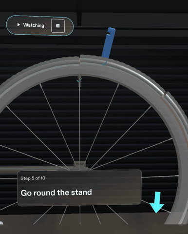
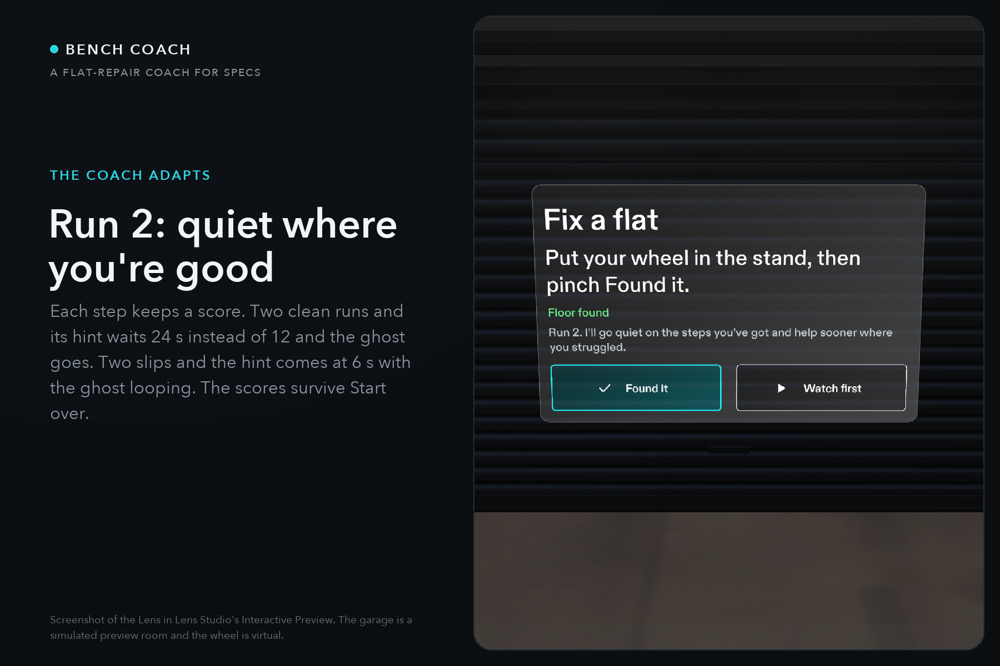
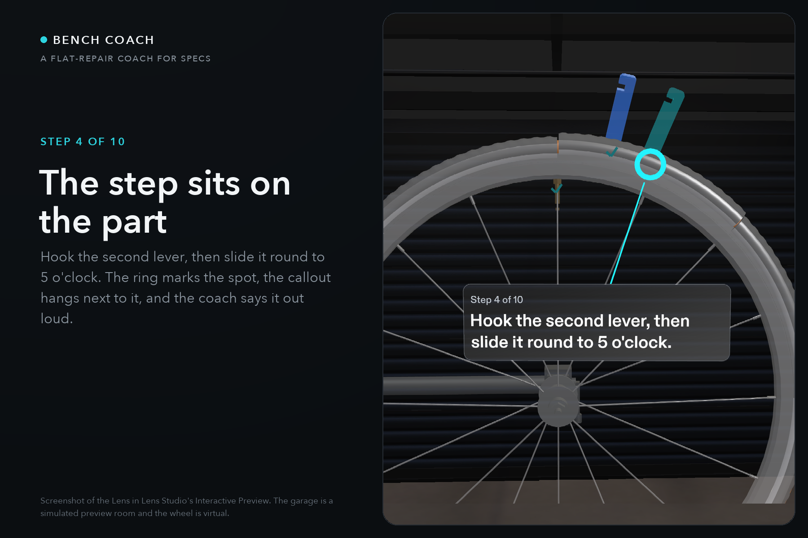
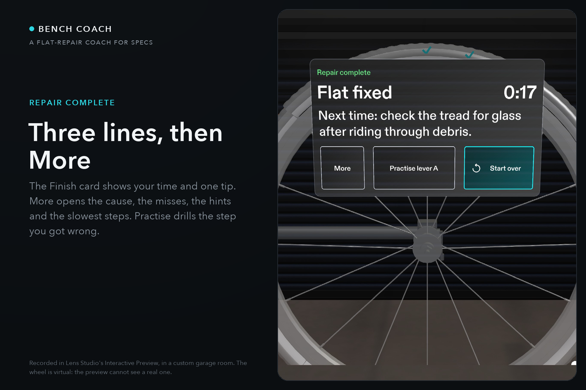

# Bench Coach

**A hands-free coach for fixing a bike flat, on Snap Specs. Every step sits on the part it is about, the coach says it out loud, and when the next step is behind the wheel, it makes you walk there.**

*Step 5 in Lens Studio's Interactive Preview. The next step is on the far side of the wheel: a chime from there, an arrow at the edge of your view, a path on the floor. The wheel is virtual; see [What is real and what is simulated](#what-is-real-and-what-is-simulated).*

Built for [Learn AR with SPECS](https://learn-specs.devpost.com/) on Devpost Learn, Oct 16 to Nov 9, 2026. Project page: [devpost.com/software/bench-coach](https://devpost.com/software/bench-coach). Planned in a design brief ([devpost/design-brief.md](devpost/design-brief.md)), built by Claude Code through CLAD and the Lens Studio MCP, tested with LEAF.

## See it in 30 seconds

- **Video:** [youtu.be/U3a3BOZxtdQ](https://youtu.be/U3a3BOZxtdQ). The Lens is on screen from 0:09. 0:26 to 1:18 is one unbroken take at real speed: the floor found, Found it, Watch first, the far side, the tube out. At 2:07 the coach adapts: run 1's slip, run 2's start card, the early hint. Captions are on.
- **In Lens Studio:** open the project, pick the Specs device and Interactive Preview, look down until the start card says "Floor found", click **Watch first**. The Lens plays steps 1 to 4 itself. At step 5 it shows the path and waits for you to walk round the stand (W, A, S, D) before it pulls the tube.
- **The moment to judge:** step 5. A screen on the bench cannot follow you round the stand.

## Who it's for

A home cyclist with a flat and no one to ask, doing it for the first time. They put the glasses on, do the repair once with the coach, and get on with their day.

**The journey:** the first run is on the virtual wheel in the stand, the trainer, because the preview cannot see a real one. On Specs the same callouts, path and voice are designed to sit on the cyclist's own wheel once the glasses can find it; until then the hand-off is the trainer, then the bike. Bench Coach is a step table and an engine (`Assets/BenchCoach/Scripts/StepDefinitions.ts` holds the ten steps; `RepairManager.ts` runs them), so a second job is a new table and its parts. Lesson two, planned and not built: a jump start, where the next step is on the other car.

The gap is real. In Cycling UK's figures 47% of adults can't fix a flat ([Cycling Plus, 2022](https://www.pressreader.com/australia/cycling-plus/20221028/281724093468028)). A shop charges £15 to £30 or more for the ten minutes ([r/BikeMechanics](https://www.reddit.com/r/BikeMechanics/comments/1glx027/how_much_are_yall_charging_for_punctures/)). U.S. PIRG puts what households could keep by repairing electronics instead of replacing them at about $49.6 billion a year ([Repair Saves Families Big II, 2023](https://pirg.org/edfund/media-center/report-fixing-instead-of-replacing-devices-could-save-americans-nearly-50-billion-a-year/)); that number is about electronics, not bikes, and the habit is the same. The usual fix is a video on a phone propped against a box: someone else's wheel, someone else's angle, a greasy thumb on the scrub bar.

**Why glasses:** both hands stay on the wheel and the levers. Each instruction is on the part, from your own angle. The next marker makes you walk to where the work is.

## How it works

**The Lens decides every step. The AI only answers questions, next to the part, and cannot move the repair.** The step order, what counts as done, every mistake and every spoken line are plain TypeScript in `Assets/BenchCoach/Scripts/`. Gemini is asked one question at a time, through Snap's Remote Service Gateway, and its answer is text beside the part. Offline, or without a token, a built-in answer is shown and tagged "Offline answer".

**Where things live**

- A repair stand with a 70 cm wheel on the floor in front of you. The Lens finds the floor first (World Query), then places the stand on it.
- The current step has one ring on its part and one callout next to it, joined by a line. Finished steps leave a small tick.
- A tool tray sits low on the right only when a lever or the new tube is needed.
- A dock sits low in front: Back, Replay, Next, More. More holds What's this?, Ask and Voice. Buttons answer a ray pinch only, so a hand passing through cannot press them.
- On step 5 an arrow at the edge of the view and a path of arrows on the floor lead to a stand-here marker behind the wheel.

**The ten steps**

1. Unthread the valve tip, then press it to let the air out.
2. Push each glowing bead toward the middle of the rim.
3. Hook the first lever under the bead, on the ghost.
4. Hook the second lever, then slide it round to 5 o'clock.
5. Go round the stand, then pull the tube out at the bottom.
6. Find the cause: look for a glint on the tire.
7. Halfway card: tube out, cause found.
8. Start at the valve, then feed the new tube in.
9. Push the bead back over the rim with your thumbs.
10. Pinch and hold the valve to pump the tire up.

**Interactions:** pinch (the valve, the beads, the glint, any part in What's this?); grab and drop (a lever from the tray onto its ghost: on the ghost it snaps in, too far away it goes back to the tray); drag (the second lever round the rim, the old tube end out, the new tube end to the valve hole); pinch and hold (the valve, to pump); walk (round the stand on step 5).

**What the coach does:** speaks every step, every mistake and every hint (30 recorded lines; Voice can be turned off). Explains seven kinds of mistake on the callout and aloud, for example the second lever before the first. Gives a hint when a step sits idle. Names any part you pinch (What's this?). Answers three questions per step next to the part (Ask). Plays the whole repair by itself (Watch first), and at step 5 waits for you to walk round. Names the cause of the flat (thorn, glass or pinch) on the Finish card with your time and one tip for next time; More opens the rest, and one button drills the step you got wrong three times.

**The coach adapts.** Each of the ten steps keeps a score from 0 to 1, starting at 0.5. When you finish a step the score moves 40% of the way toward a target: 1 for a clean step inside its par time, 0.5 for one slip (a lever miss, a mistake or a hint) or a slow one, 0 for two or more slips. Above 0.75 the step is yours: the hint waits 24 s instead of 12, the ghost lever shows the motion once and goes, and the hint is shown but not spoken. At 0.35 or below the step needs help: the hint comes at 6 s, the ghost keeps looping until the lever is placed, and the hint is spoken. The scores and a run count are kept in the Lens's persistent store, so on your second run the start card says so and the More view of the Finish card reads, for example, "Coach memory: lever A needs help; deflate and loosen are yours." The steps themselves never change; only how much the coach helps. Two clean runs make a step yours; two slips on one run make it need help. It is a score and a rule, nothing is trained.

| What | Where it is decided |
| --- | --- |
| The step order and what counts as done | `Assets/BenchCoach/Scripts/RepairManager.ts`, `Assets/BenchCoach/Scripts/StepDefinitions.ts` |
| The wheel, tire, beads and tube, built in code so they lift, peel and deflate | `Assets/BenchCoach/Scripts/WheelParts.ts`, `Assets/BenchCoach/Scripts/MeshKit.ts` |
| Lever snap, the rim drag, the tube pull | `Assets/BenchCoach/Scripts/LeverPlacement.ts`, `Assets/BenchCoach/Scripts/RimDrag.ts`, `Assets/BenchCoach/Scripts/TubePull.ts` |
| The far-side cue: edge arrow, floor path, stand-here marker | `Assets/BenchCoach/Scripts/EdgeHint.ts`, `Assets/BenchCoach/Scripts/FloorPath.ts` |
| The floor, found with World Query and settled | `Assets/BenchCoach/Scripts/FloorLevel.ts` |
| Mistakes and their reasons | `Assets/BenchCoach/Scripts/CoachFeedback.ts` |
| The coach's voice (30 clips, one per line) | `Assets/BenchCoach/Scripts/VoiceCoach.ts`, `Assets/BenchCoach/Voice/` |
| Ask: Gemini through Remote Service Gateway, 6 s timeout, offline fallback | `Assets/BenchCoach/Scripts/AskCoach.ts` |
| Watch first | `Assets/BenchCoach/Scripts/RepairDirector.ts`, `Assets/BenchCoach/Scripts/WatchPlan.ts` |
| The Finish card's counts, slowest steps and tip | `Assets/BenchCoach/Scripts/RunStats.ts`, `Assets/BenchCoach/Scripts/BenchCoachFinishCardUI.ts` |
| The coach adapts: a score per step, moved toward a reward target when the step is done, sets how soon the hint comes, whether the ghost loops and whether the hint is spoken | `Assets/BenchCoach/Scripts/AdaptiveCoach.ts`, the `parSec` column in `Assets/BenchCoach/Scripts/StepDefinitions.ts` |

## Tests and evidence

23 LEAF scenarios drive the Lens in the preview, one per done criterion, plus a `jump-to-step` helper that puts the Lens on any step for screenshots and video takes. Last full run: Nov 7, 2026, Lens Studio 5.24.1, all 23 in the Garage preview room (`ask-coach-fallback` on its second run; its first tap hung before the Lens changed). The Nov 6 run of the first 22 also passed in Sunlit Room. Every number in this README comes from a command in [docs/REPO_FACTS.md](docs/REPO_FACTS.md) or from the source linked beside it.

| # | Done criterion | LEAF test | Status |
|---|---|---|---|
| 1 | Found it places the wheel in the stand, the scan reveal plays, and step 1's ring sits on the valve | `start` | Passed |
| 2 | Steps 1 and 2 finish by pinching the valve and the four lit beads; only the current step's ring shows | `deflate-loosen` | Passed |
| 3 | Lever A dropped 10 cm off the ghost goes back to the tray; dropped on the ghost it snaps in and lifts the bead | `lever-snap` | Passed |
| 4 | Lever B slides round to 5 o'clock and peels the bead; the far-side ring and edge arrow come on; pulling the tube end takes the tube out piece by piece | `peel-and-pull` | Passed |
| 5 | Pinching the cause reveals it and ends the first half; Back undoes every step exactly; Replay does something on every step | `inspect-done` | Passed |
| 6 | Finished steps leave one tick each, none stacked; Back removes the tick it undoes | `step-ticks` | Passed |
| 7 | The tube is hidden until a bead lifts; the valve hisses; only the parts of the current step glow; the stand stands on the measured floor | `scene-dressing` | Passed |
| 8 | Dragging the new tube end to the valve hole fits the tube; Back takes it out again | `refit-tube` | Passed |
| 9 | Seating four beads and holding the valve for 3 s inflates the tire and shows the Finish card | `seat-inflate` | Passed |
| 10 | What's this? pauses the step and names any part that is pinched | `whats-this` | Passed |
| 11 | Each of the seven mistakes plays its sound, shows its reason and leaves the step unchanged | `mistakes` | Passed |
| 12 | Thorn, glass and pinch each sit at their own place on the tire and are named on the Finish card | `flat-causes` | Passed |
| 13 | The progress rail lights finished steps; an idle step shows its hint once | `progress-idle` | Passed |
| 14 | Watch first plays the repair by itself; Next stops it and moves one step; it can resume to the Finish card | `watch-mode` | Passed |
| 15 | Ask opens three questions for the step and puts the offline answer next to the part within 2 s | `ask-coach-fallback` | Passed |
| 16 | On step 5 at least six arrows lie on the floor, clear of the stand, and end behind the wheel; arriving there hides them | `floor-path` | Passed |
| 17 | After a run with real mistakes the Finish card lists the slowest steps and the tip for the most frequent mistake | `coach-report` | Passed |
| 18 | Dock buttons do not overlap, answer only a ray pinch, and each does one thing | `control-bar` | Passed |
| 19 | The floor is the lowest wide level; a lower level found later moves the stand, mat and path down together | `floor-level` | Passed |
| 20 | No text crosses its plate, no callout covers the tire or another callout, and text is at least 0.55 degrees tall | `ui-layout` | Passed |
| 21 | The coach speaks on each step, a mistake cuts in, no line repeats within 6 s, and Voice off is silent | `voice-coach` | Passed |
| 22 | The Finish card's Practise button drills the step of the most frequent mistake three times and reports the reps and the best time | `practise-step` | Passed |
| 23 | After two clean runs of a step its hint waits 24 s and the ghost goes; after two slips on a step its hint comes at 6 s and the ghost loops; the scores survive Start over and the More view names them | `adaptive-coach` | Passed |

The first five are the design brief's done criteria. The scenarios are in `Assets/BenchCoach/Tests/`, registered in `Assets/BenchCoach/Tests/LeafIndex.ts`. The build itself is on record: 36 dated passes in [devpost/design-notes.md](devpost/design-notes.md), each with what changed, what was checked and what was left over, and a generated [devpost/build-log.md](devpost/build-log.md) with 22 sessions, 3406 Lens Studio MCP calls and 1005 LEAF runs.

## What is real and what is simulated

1. **Real:** the Lens. Every step, mistake, hint, spoken line and card in the video is the Lens running in Lens Studio's Interactive Preview, and the tests drive that same Lens.
2. **Simulated:** the wheel and the stand are virtual. The preview cannot see a real wheel, so the Found it pinch places one. The design is for your own wheel; the virtual one is the stand-in until the glasses can find a real one.
3. **Simulated:** the garage in the video is a preview room (`preview-room/`). It is not part of the Lens.
4. **Not the Lens:** the first nine seconds of the video are an AI-generated clip of the problem (a man in a garage with a flat and a video on a propped-up phone). It is labelled on screen. The Lens is on screen from 0:09.
5. **Offline:** no tokens are in this repo, so Ask gives its built-in answers in the tests and in the video, tagged "Offline answer". Live answers need a Remote Service Gateway token and internet.
6. **Not used:** the camera. Nothing is recognised. The Lens draws, speaks and listens for pinches.
7. **Logic proven** (tests and preview): the step order, the lever snap, the bead peel, the tube pull and refit, inflation, every mistake, the far-side cue and floor path, what shows when, when the coach speaks, text size and overlap, floor finding in the Garage room, the scores the coach keeps and what they change.
8. **Feel unproven** (needs real glasses): the Lens has never run on Specs. Lining the virtual wheel up with a real one, how a lever feels in the hand, whether a ghost tool reads against a real tire, voice volume in a real workshop, text size on the real display.
9. **Known gap:** in Sunlit Room, from the default pose, the floor finder can settle on the sofa seat instead of the floor.

## Not built

- Running on Specs hardware. Everything here is the Lens Studio preview.
- Finding and lining up with a real wheel.
- Any repair other than a flat. The halfway card names brake pads as the next skill, and it is only a name.
- Custom or two-hand gestures, hand pose, voice input, two people in one Lens. The only thing kept between sessions is the coach memory: ten step scores and a run count.

## Design

The brief came first: [devpost/design-brief.md](devpost/design-brief.md), written on Oct 22 as answers to the `plan-lens` questions (the one spatial moment, why glasses, product or overlay, where things live in centimetres, hands, when things show, five done criteria), and it ends with what the build changed. The rules it follows are the ones the judges gave on Oct 29 and Nov 5, and Snap's own numbers.

| Rule | What Bench Coach does |
| --- | --- |
| Don't put a website in front of your face | One callout at a time, on the part. The Finish card is three lines and one tip; the rest is behind More |
| Show only what needs to be displayed | The tray appears on lever steps only. Hints appear after 12 idle seconds, 24 on a step you have down, 6 on one you have slipped on. What's this? and Ask are on demand |
| Big buttons, few of them | Four dock buttons, each at or above Snap's minimum target size for its distance, ray pinch only |
| Draw things that exist in that world | Every instruction sits on its part with a leader. The ghost lever is at the exact target pose. The path is on the floor |
| Keep content in the centre cone, a little below eye level | The wheel at 90 cm, hub 100 cm off the floor; callouts inside the frustum at the working pose (`ui-layout` checks it) |
| The display is additive | Mid grey wheel, light type and outlines, no signal by colour alone: ticks, badges and words go with every colour |

More captures, each labelled: [devpost/gallery/](devpost/gallery/).

## Run it

1. Install Lens Studio 5.24.1 or newer and Git LFS (`git lfs install`), then clone this repo. The voice clips and textures are LFS files.
2. Open `Specs Base Template.esproj`.
3. In the Preview panel pick the Specs device and Interactive Preview. Any built-in room works. To use the garage from the video, see [preview-room/README.md](preview-room/README.md).
4. Look down at the floor until the start card says "Floor found" (about 5 s looking straight down, up to 12 s otherwise), then click Found it, or Watch first to see the whole repair.
5. Move with W, A, S and D, Q and E for down and up, right-drag or Shift to look. A click acts as a pinch.
6. Ask works offline as is. For live answers follow [tools/set-coach-tokens.md](tools/set-coach-tokens.md). Never commit tokens; `tools/check-no-tokens.sh` checks.

## Test it

The tests run inside Lens Studio against the live preview; there is no command-line runner.

1. Open the project and the Preview panel as above. The LEAF package is already installed and `Assets/BenchCoach/Tests/LeafIndex.ts` is attached in the scene.
2. Open the LEAF panel. It lists the 23 scenarios and `jump-to-step`.
3. Run scenarios one at a time. Each resets the Lens, drives it with simulated pinches, grabs and drags, and reports pass or fail with its assertions in the Logger panel.
4. Three to run first if you have two minutes: `start` (the wheel appears and step 1's ring is on the valve), `lever-snap` (a lever dropped 10 cm off the ghost goes back to the tray), `floor-path` (the arrows and the stand-here marker on step 5).
5. To put the Lens on any step by hand, run `jump-to-step` and set its `step` input (0 to 11) and `watch` (1 to let Watch first continue from there).

To regenerate the numbers quoted here: `python3 ~/.claude/skills/devpost/scripts/collect_facts.py . --no-tests` writes [docs/REPO_FACTS.md](docs/REPO_FACTS.md) with the command beside every value.

## Project layout

| Path | What it is |
| --- | --- |
| `Specs Base Template.esproj` | The Lens Studio project. Open this |
| `Assets/BenchCoach/Scripts/` | The Lens: 50 TypeScript files, 13,830 lines |
| `Assets/BenchCoach/Tests/` | 23 LEAF scenarios, the `jump-to-step` helper and `LeafIndex.ts` |
| `Assets/BenchCoach/Voice/` | The coach's 30 recorded lines and `voice-lines.json` |
| `Assets/GeneratedSFX/` | Nine sound cues made with code during the build |
| `devpost/design-brief.md` | The plan, written before the first build, with what the build changed |
| `devpost/design-notes.md` | 36 dated build passes: what changed, what was checked, what was left |
| `devpost/build-log.md` | Generated from the session logs: sessions, MCP calls, LEAF runs |
| `devpost/video-script.md` | The video as cut, shot by shot, with what is sped up or simulated |
| `devpost/gallery/` | Captures and the GIF above, each labelled |
| `preview-room/` | The garage preview room used in the video |
| `tools/` | The token check, the token setters and the build-log generator |

## What we learned

- **Plan in centimetres, then let the tests hold the plan.** The brief's five done criteria became the first five LEAF scenarios, and every later feature had to add its own before it counted as built. The suite is what let a floor change on Oct 28 and a UI rewrite on Nov 1 land without breaking the repair.
- **A guess that works in one room is still a guess.** The floor was assumed to be 150 cm below the eye. In one preview room the stand floated over a table. `FloorLevel.ts` now takes the lowest wide level World Query has seen, and a lower level found later moves the stand, the mat and the path together.
- **The judges' rules are measurable.** "A website on your face" became a line count on the Finish card. "Big buttons" became degrees on the collider in `ui-layout`. "Show it only when needed" became the idle timer and the on-demand menu. Each one is a test now, not an opinion.

**Next:** run it on Specs, find the real wheel, and keep the callouts where they are. Then lesson two, a jump start: the same engine, a new step table, and the walk is between two cars.

## Credits

- Spectacles Interaction Kit, Spectacles UI Kit, LEAF, Remote Service Gateway, Utilities and SnapDecorators packages by Snap, and the Specs Base Template.
- Coach voice: generated with [ElevenLabs](https://elevenlabs.io), voice "River". Video narration: ElevenLabs, voice "Chris".
- Opening clip of the video: AI-generated (a video model, Nov 7, 2026), with its own generated voice.
- Sound effects and the finish jingle: made with code during the build (CLAD `build-sfx` and `build-music`).
- Icons: Google Material Symbols.
- Garage preview room: sources listed in [preview-room/README.md](preview-room/README.md).
- Repair procedure based on Park Tool's "Tire and Tube Removal and Installation".
- Built by Anudeep Bonagiri, Sujeeth Thatiparthi and Sudeep, with Claude Code (planning, every build pass through CLAD and the Lens Studio MCP, the tests, the notes). No pre-existing code beyond the Snap packages and the template.

## License

MIT
